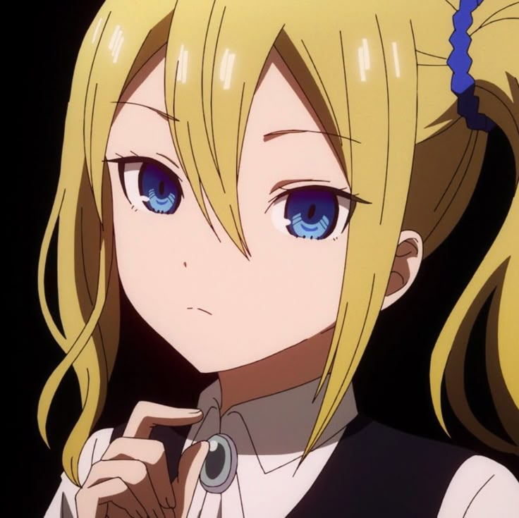

  

  <h1>Hey, I'm Sneg 👋</h1>

  

    <b>Python dev</b> from Belgium &nbsp;•&nbsp; building AI video tools 
    <i>Hayasaka believer, AMV enjoyer, terminal dweller</i>
  

  

  

    
    
    
  

  

---

## 🧋 About

I write **Python** for fun and profit, mostly around **video, AI and image** work.
Right now I'm obsessed with making ML segmentation tools that editors can actually use —
local, fast, no account required, no cloud nonsense.

When I'm not coding you'll find me making AMVs, collecting Hayasaka screenshots
and pretending my todo list isn't 40 items long.

## 🛠️ Toolbox

!Python
!PyTorch
!PySide6
!Git
!Linux
!VS Code
!FFmpeg

## ✨ Featured

<table>
  <tr>
    <td width="120" valign="top">
      
    </td>
    <td valign="top">
      <h3><a href="https://github.com/SnegOwo/Better-Brush">Better-Brush</a></h3>
      

        Free, source-available <b>AI rotoscoping studio</b> for video editors. 
        SAM&nbsp;2 segmentation, propagation, matting, object removal & alpha export.
      

      

        
        
        
      

      
🌐 <a href="https://snegowo.github.io/Better-Brush/">Live demo</a>

    </td>
  </tr>
</table>

## 📊 GitHub stats

<picture>
  <source media="(prefers-color-scheme: dark)" srcset="https://github-readme-stats.vercel.app/api?username=SnegOwo&show_icons=true&hide_border=true&bg_color=0d1117&title_color=FFD21E&icon_color=4A90D9&text_color=c9d1d9" />
  
</picture>

## 🔗 Find me

&nbsp;

&nbsp;

 

Made with 🍓 and too much Hayasaka. Thanks for stopping by!
