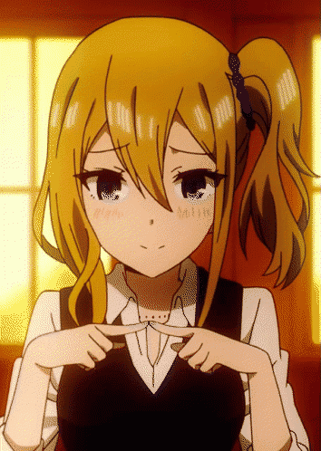
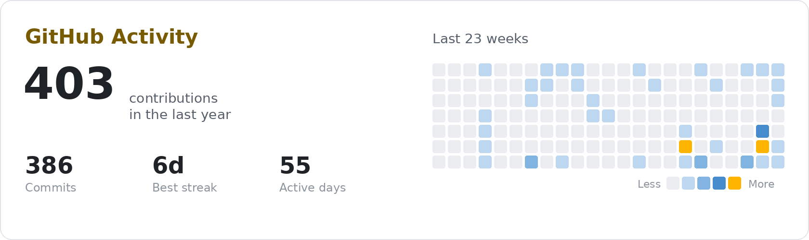

  <h1>Hey, I'm Sneg 👋</h1>

  

    <b>From Belgium</b> &nbsp;•&nbsp; AI, tech &amp; too much Hayasaka
  

  

   
   

  
  
  

   
   

  

   

  

---

## 🪶 About

Belgian developer, AI enthusiast and technology lover.

## ✨ Featured

<table>
  <tr>
    <td width="120" valign="top">
      
    </td>
    <td valign="top">
      <h3><a href="https://github.com/SnegOwo/Better-Brush">Better-Brush</a></h3>
      

        Free, source-available <b>AI rotoscoping studio</b> for video editors. 
        SAM&nbsp;2 segmentation, propagation, matting, object removal & alpha export.
      

      

        
        
        
      

      
🎬 <a href="https://www.youtube.com/playlist?list=PLEmNRCGk7DI0">Watch the walkthrough playlist</a>

    </td>
  </tr>
</table>

## 📊 Activity

<picture>
  <source media="(prefers-color-scheme: dark)" srcset="assets/activity-dark.png" width="840" />
  
</picture>

Refreshed automatically every day.

## 🔗 Find me

&nbsp;

&nbsp;

 

Made with 🍓 and too much Hayasaka. Thanks for stopping by!
